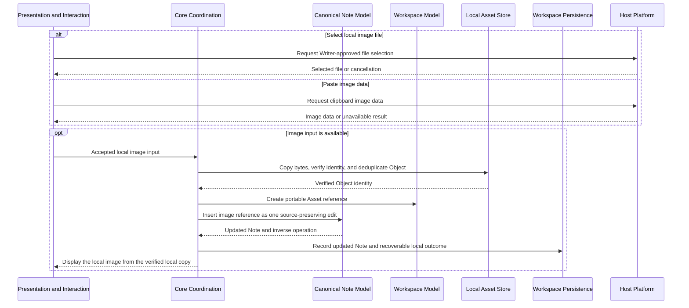

# Local Asset import flow

The active path accepts a local image through file selection or clipboard paste. Both inputs create the same verified local Asset outcome and remain independent of Remote synchronization.

CAP-059 and CAP-060 retain ownership of existing-collection Asset adoption, but that workflow is deferred and doesn't expand this active flow. Drag-and-drop input is also deferred. CAP-057 remains owned by the Object Store lifecycle flow.

## Failure path

- Imported source locations never remain dependencies after a successful copy.
- Cancellation or unavailable clipboard image data leaves the Note and Local Asset Store unchanged.
- A copy, identity, reference, or persistence failure leaves the Note unchanged and preserves every verified byte already present.
- Undo removes the inserted Note reference through its inverse editing operation. Object retention remains governed by Protected State rather than by immediate deletion.
- Same bytes reuse one Object. Different local bytes for one reference enter Object recovery; competing Asset outcomes produced by Remote reconciliation require an Asset Decision.
- Missing or corrupt local Objects preserve every verified copy and enter the Object recovery flow, which offers Retry, Repair from local copy, Choose replacement, or Remove reference when valid. Local corruption doesn't create an Asset Decision. Synchronization pauses only when Object availability or a separately created reconciliation decision makes publication unsafe.
