# Remote connection and authorization flow

This flow covers burlmd's OAuth product authorization, connection or join of the same private Workspace, privacy loss, sign-out, reauthorization, and safe detachment. Provider approval remains under the Writer's control. Pasted personal credentials and inherited command-line authorization don't substitute for this product flow. Stage 3 specifies the physical authorization contract for the established device OAuth flow.

```mermaid
stateDiagram-v2
    [*] --> LocalOnly
    LocalOnly --> Authorizing: Writer starts connection or join through burlmd
    Authorizing --> Selecting: Provider authorization and access valid
    Authorizing --> LocalOnly: Cancel, pending approval, or failure
    Authorizing --> AttachedUnauthenticated: Reauthorization fails for an attached Workspace
    Selecting --> PreparingLocal: Empty eligible private Remote selected or provisioned
    Selecting --> PreparingJoin: Existing attached private Remote selected on another device
    PreparingLocal --> Connected: Notes and protected Objects verified and local history published
    PreparingJoin --> Connected: Complete local Workspace created and active Assets available
    PreparingLocal --> LocalOnly: Cancel or prerequisite failure
    PreparingJoin --> LocalOnly: Cancel or incomplete local materialization
    Connected --> Refreshing: Authorization nearing expiry
    Refreshing --> Connected: Credentials rotate
    Refreshing --> AuthenticationRequired: Authoritative rejection or revocation
    Refreshing --> RefreshOffline: Transport unavailable
    Refreshing --> RefreshRateLimited: Provider rate limit
    Refreshing --> RefreshRetryable: Retryable service failure
    RefreshOffline --> Refreshing: Connectivity returns
    RefreshRateLimited --> Refreshing: Retry window opens
    RefreshRetryable --> Refreshing: Retry condition clears
    Connected --> PausedPrivacy: Remote becomes public or access is lost
    AuthenticationRequired --> Authorizing: Reauthorize through burlmd
    AuthenticationRequired --> DetachPreparing: Writer requests explicit detach
    PausedPrivacy --> Connected: Private access restored
    PausedPrivacy --> DetachPreparing: Writer requests explicit detach
    Connected --> AttachedUnauthenticated: Writer signs out; Remote remains attached
    AttachedUnauthenticated --> Authorizing: Reauthorize through burlmd
    AttachedUnauthenticated --> DetachPreparing: Writer requests explicit detach
    Connected --> DetachPreparing: Writer requests explicit detach
    DetachPreparing --> LocalOnly: Local history and protected Objects verified, atomic detach completes
    DetachPreparing --> DetachHeld: Writer cancels or bound authority changes
    DetachPreparing --> LocalWithObjectStore: Remote detaches offline; Object Store remains attached
    DetachHeld --> Connected: Prior private connection remains valid
    DetachHeld --> Authorizing: Reauthorization is required
    DetachHeld --> PausedPrivacy: Privacy or access remains invalid
    LocalWithObjectStore --> Authorizing: Reconnect exact prior Remote for complete local detach
```

CAP-070 retains ownership of Consolidation between independent collections. Consolidation is deferred and doesn't add a branch to this connection and join flow.

## Failure path

- Authorization, approval, selection, provisioning, publication, join, or detachment failure leaves local capabilities available.
- An incomplete join never becomes authoritative. It removes or isolates partial materialization and preserves any earlier local state.
- Transport, service, and rate-limit failures don't become authentication-required states.
- Refresh retry states preserve Remote attachment and the current credential pair until rotation succeeds or the Provider authoritatively rejects it.
- A first connection publishes only after Object prerequisites pass for an asset-bearing Workspace.
- First publication and later pushes stop if any commit reachable from a local publication ref contains `.github/workflows/**`. burlmd doesn't request GitHub workflow-modification permission. Local use remains available, and the Writer can manually transfer Notes and Assets into a fresh conforming Workspace before retrying connection.
- Sign-out removes credentials but not Remote attachment. Safe full-local detachment preserves local history and protected images, and it never deletes remote data.
- If fresh authority, local hydration, or the bound Workspace revision can't be verified, detachment preserves the existing connection state. An offline Remote detach retains the Object Store and requires reconnection to the exact prior Remote before complete local detachment.
