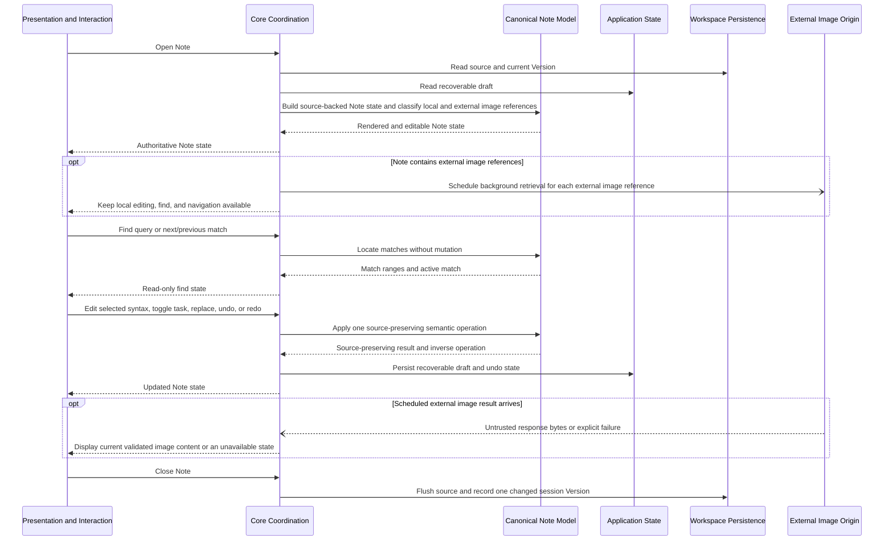

# Edit Note flow

This flow covers the delivered editing baseline, local history and draft durability, complete Note-level undo and redo, in-Note find and replace, the selected P0 Markdown syntax, and external Markdown image loading.

## Failure path

- If draft persistence fails, Core reports unwritten state and doesn't claim durability.
- If the source revision changed, Core preserves the draft and routes the candidate disk change through the guest-change flow.
- Find queries and match navigation are read-only. They don't create inverse operations, drafts, or undo entries.
- Replace-all and every other delivered content-editing operation apply with one reversible Note-level outcome or leave the Note unchanged.
- A failed, unavailable, or invalid external image response produces an unavailable state for that image. It doesn't block Note opening, local editing, or offline use, and it doesn't rewrite or import the external reference.
- If the Note closes or its external reference changes before a response arrives, Core discards the stale result without reopening or editing the Note.
- External image requests carry only what each reference requires. Other Note content, application credentials, and telemetry don't cross the boundary.
- A close warning or failure follows the desktop-session flow.
