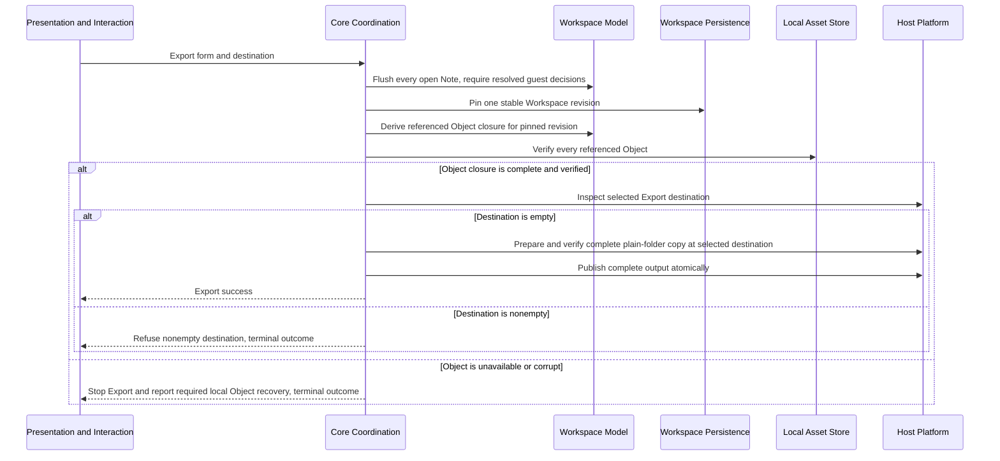

# Workspace Export flow

**Maps to:** CAP-PORT-02, CAP-PORT-06, CAP-PORT-07, CAP-PORT-08.

Bundle Archive Export is deferred and doesn't add an archive or replacement branch to this flow. A connected Workspace can recover an unavailable Object through the Object lifecycle before the Writer retries Export, but a complete local Object closure never depends on Remote synchronization.

## Failure path

- A flush failure or unresolved guest decision stops Export before revision capture.
- A read, write, or verification failure removes temporary output and doesn't expose partial success.
- A missing or corrupt local Object stops publication and reports Object recovery without making connected storage a prerequisite for complete local Export.
- Foreign nonconforming content remains byte-preserved in Export and is reported rather than silently repaired.
