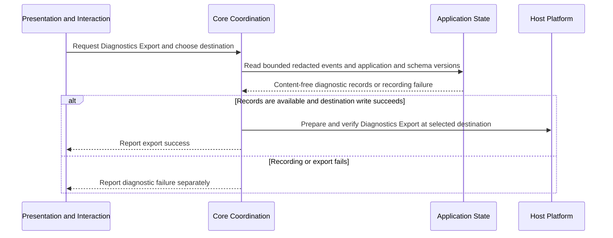

# Local diagnostics flow

The active path records bounded content-free diagnostics and creates a Diagnostics Export only when the Writer requests one. Local Version capture continues through Workspace Persistence, but in-app Version listing and restore under CAP-044 are deferred.

## Failure path

- Diagnostics generation fails rather than including Note bytes, Asset bytes, credentials, signed locations, or content-derived metadata.
- Recording failure doesn't fail or roll back the Writer's original product operation and doesn't change Workspace data.
- Export failure doesn't claim success or expose a partial Diagnostics Export at the selected destination.
- No diagnostic record or Diagnostics Export leaves the device automatically.
