# Object Store lifecycle flow

The active synchronization path uses one configured Object Store, permits credential updates, hydrates protected images, pauses safely on privacy or integrity failure, and can return the Workspace to complete local-only use.

```mermaid
stateDiagram-v2
    [*] --> FullyLocal
    FullyLocal --> ValidateLocalStore: Connect one Object Store
    ValidateLocalStore --> LocalWithObjectStore: Privacy, access, and required operations verified
    ValidateLocalStore --> FullyLocal: Cancel or validation fails
    FullyLocal --> RemoteWithoutObjectStore: Asset-free Remote connects
    LocalWithObjectStore --> RemoteWithObjectStore: Remote connects or exact prior Remote reconnects
    RemoteWithObjectStore --> LocalWithObjectStore: Offline Remote detach retains Object Store
    RemoteWithObjectStore --> HydratingRemote: Join or restore needs Objects
    HydratingRemote --> RemoteWithObjectStore: Active Objects first; remaining obligations durable
    RemoteWithObjectStore --> RemoteAssetRecovery: Missing or corrupt Object pauses affected synchronization
    RemoteWithObjectStore --> PausedObjectPrivacy: Scheduled or prepublication privacy probe is stale or fails
    PausedObjectPrivacy --> RemoteWithObjectStore: Fresh probe denies anonymous List, Get, Put, and Delete
    LocalWithObjectStore --> LocalAssetRecovery: Missing or corrupt Object needs recovery
    HydratingRemote --> RemoteAssetRecovery: Identity verification fails
    RemoteAssetRecovery --> RemoteWithObjectStore: Repair, replacement, or reference removal verifies
    RemoteAssetRecovery --> RemoteAssetRecovery: Retry remains unresolved
    LocalAssetRecovery --> LocalWithObjectStore: Repair, replacement, or reference removal verifies
    LocalAssetRecovery --> LocalAssetRecovery: Retry remains unresolved
    LocalWithObjectStore --> UpdatingLocalCredentials: Writer updates credentials
    RemoteWithObjectStore --> UpdatingRemoteCredentials: Writer updates credentials
    UpdatingLocalCredentials --> LocalWithObjectStore: Replacement validates, or earlier credentials remain after cancel or failure
    UpdatingRemoteCredentials --> RemoteWithObjectStore: Replacement validates, or earlier credentials remain after cancel or failure
    RemoteWithObjectStore --> DetachUnusedStore: Writer requests Object Store-only detach
    DetachUnusedStore --> RemoteWithoutObjectStore: Complete protected set is empty; Object Store detaches and Remote remains
    DetachUnusedStore --> RemoteWithObjectStore: Any protected reference exists or enumeration is stale/incomplete
    RemoteWithoutObjectStore --> ValidateRemoteStore: Writer reconnects an Object Store
    ValidateRemoteStore --> RemoteWithObjectStore: Private access and required operations verified
    ValidateRemoteStore --> RemoteWithoutObjectStore: Validation fails
    RemoteWithoutObjectStore --> FullyLocal: Writer detaches the Remote
    RemoteWithObjectStore --> RevalidatingRemote: Return Workspace to fully local
    RevalidatingRemote --> Detaching: Fresh published refs and protected closure verified
    RevalidatingRemote --> RemoteWithObjectStore: Offline, unauthorized, incomplete, or stale
    Detaching --> FullyLocal: Every Protected State hydrated; Object Store and Remote detach
    Detaching --> RemoteWithObjectStore: Cancel, retrieval failure, or bound authority advances
```

CAP-058 retains ownership of automatic local image cleanup, but that operation is deferred and downloaded Objects remain local. Object Store replacement is also deferred. Neither deferred operation adds states to this active lifecycle.

## Failure path

- Any anonymous list, read, write, or delete permission—or unknown privacy—refuses connection. While synchronized, all four permissions are revalidated on startup, before publication batches, and periodically; stale or failed evidence pauses Object transfer and history publication while local work remains available.
- Credential rotation validates replacements before removing earlier local credentials.
- Missing or corrupt bytes never become visible before identity verification. Asset Recovery preserves every verified copy and exposes only valid recovery actions.
- Downloaded Object copies remain local during the active synchronization milestone. burlmd doesn't delete authoritative Object Store bytes during `0.x`.
- An asset-bearing Workspace never remains Remote-connected without a verified Object Store.
- A Remote-connected Workspace with no protected Object references may detach only the Object Store after complete current, local-history, published-history, pending-reconciliation, and Consolidation enumeration proves the protected set empty. The Remote remains attached.
- Offline Remote detachment moves `RemoteWithObjectStore` to `LocalWithObjectStore`; it removes local Remote attachment state and retains the Object Store. The Writer must reconnect the exact prior Remote before a full-local transition. That transition requires authenticated online enumeration of every published Remote ref immediately before Protected Object hydration, consumes readiness bound to that ref inventory and the Workspace revision, and refuses if either advances before atomic detach.
- Cancellation, retrieval failure, stale authority, or a changed bound revision preserves the attached state and every verified local Object. The lifecycle never reports complete detachment from partial work.
