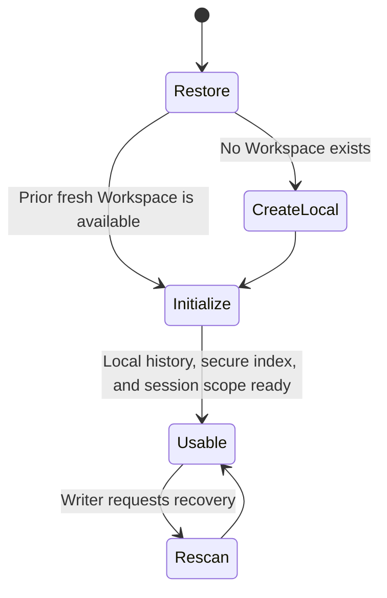

# Workspace bootstrap flow

The active first-use path creates or restores one fresh local Workspace without an account or network connection.

Every entry path converges on one active Workspace with local history, secure aggregate indexing, authority state, and per-Workspace session scope.

CAP-036 and CAP-043 retain ownership of existing-collection adoption and multiple-Workspace interfaces. Those workflows are deferred and don't expand this first-use flow. Joining the same connected Workspace belongs to the Remote connection flow.

## Failure path

- Secure index setup failure never falls back to an unprotected aggregate index.
- Missing or unusable restored session state falls back to a safe local bootstrap outcome without rewriting Note bytes.
- A failed initialization preserves any complete earlier Workspace state and doesn't claim the partial state as usable.
- Rescan failure leaves the last authoritative Workspace state available and reports the recovery failure.
