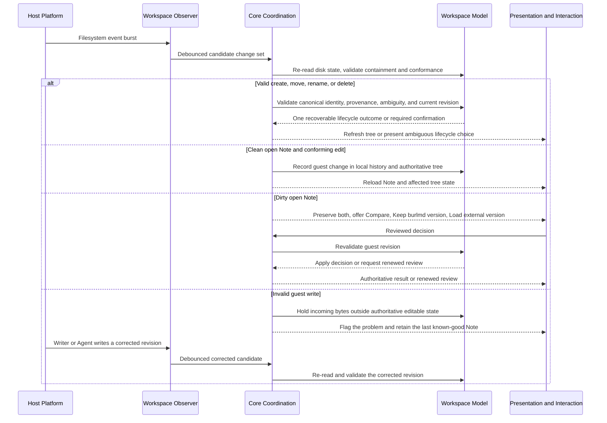

# Live Workspace monitoring flow

**Maps to:** CAP-WS-07, CAP-WS-08, CAP-WS-09, CAP-WS-10, CAP-WS-11, CAP-WS-12, CAP-PORT-03.

## Failure path

- Missed, duplicate, or reordered events converge by comparing candidate events with disk state.
- Invalid input remains preserved and visible as a problem but can't replace or become editable as authoritative state. Guided repair is deferred.
- A revision change between review and apply invalidates the decision.
- Ambiguous lifecycle provenance or identity requires confirmation. A revision change before application renews that confirmation.
- If automatic observation can't prove completeness, it preserves authoritative state and reports the degraded observation state. Rescan rebuilds observation state as an explicit recovery path.
