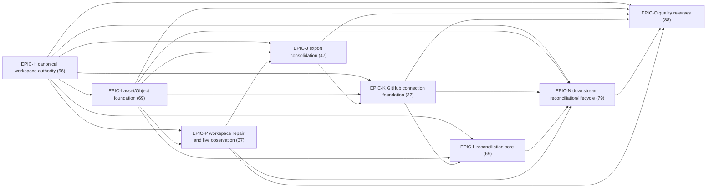

# Critical path

Generated by `constitution-tooling render` from `tasks/epics/`. Do not edit by hand; change the epic files and render again.

## Totals

| Active epics | Open points | Out-of-band epics | Out-of-band points | Waves | Widest wave | Longest chain (points) |
| :--- | :--- | :--- | :--- | :--- | :--- | :--- |
| 8 | 482 | 0 | 0 | 8 | 1 | 482 |

## Longest chain

EPIC-H → EPIC-I → EPIC-P → EPIC-J → EPIC-K → EPIC-L → EPIC-N → EPIC-O (482 points). This bounds wall-clock time however many lanes run.

## Waves

An epic joins a wave when every dependency sits in an earlier wave and it is scope-disjoint from every other epic in the wave. A wave of one is a serial segment.

| Wave | Epic | Kind | Open points | Owns | May patch | Depends on |
| :--- | :--- | :--- | :--- | :--- | :--- | :--- |
| 1 | EPIC-H canonical workspace authority | product | 56 | `.constitution/prototypes/ast/**`, `.constitution/spikes/SPK-BURL-H001.md`, `.constitution/prototypes/path/**`, `.constitution/spikes/SPK-BURL-H002.md`, `rust/src/markdown/**`, `rust/src/draft.rs`, `rust/Cargo.toml`, `rust/Cargo.lock`, `rust/src/api/**`, `rust/src/index/**`, `rust/src/workspace/**`, `lib/src/rust/**`, `lib/src/components/block_view.dart`, `lib/src/components/editor.dart`, `lib/src/providers/rust_api_provider.dart`, `test/**`, `rust/src/okf/concept_id.rs`, `rust/src/db/**`, `rust/src/api/ffi_api.rs`, `rust/src/workspace/bootstrap.rs`, `rust/src/index/scan.rs`, `rust/src/okf/**`, `lib/src/components/**` | — | — |
| 2 | EPIC-I asset/Object foundation | foundation | 69 | `.constitution/prototypes/assets/**`, `.constitution/spikes/SPK-BURL-I001.md`, `rust/src/assets/**`, `rust/src/workspace/**`, `rust/src/git/operations.rs`, `rust/src/api/ffi_api.rs`, `rust/Cargo.toml`, `rust/Cargo.lock`, `test/**`, `rust/src/markdown/**`, `lib/src/components/editor.dart`, `lib/src/components/block_view.dart`, `lib/src/providers/note_providers.dart`, `pubspec.yaml`, `pubspec.lock`, `linux/**`, `macos/**`, `integration_test/**`, `rust/src/object_store/**`, `rust/src/security/**`, `lib/src/components/**`, `rust/src/sync/**`, `lib/src/providers/**`, `rust/src/workspace/bootstrap.rs` | — | EPIC-H |
| 3 | EPIC-P workspace repair and live observation | product | 37 | `rust/src/okf/**`, `rust/src/workspace/**`, `rust/src/api/ffi_api.rs`, `lib/src/components/**`, `test/**`, `rust/src/api/**`, `rust/Cargo.toml`, `rust/Cargo.lock`, `.constitution/evidence/BURL-P002/**`, `rust/src/index/**`, `rust/src/git/operations.rs`, `lib/src/providers/workspace_provider.dart`, `lib/src/providers/note_providers.dart`, `rust/src/index/scan.rs`, `lib/src/screens/workspace.dart`, `test/screens/workspace_rescan_test.dart` | — | EPIC-H, EPIC-I |
| 4 | EPIC-J export consolidation | product | 47 | `rust/src/workspace/**`, `rust/src/api/ffi_api.rs`, `test/**`, `rust/src/export/**`, `rust/src/assets/**`, `lib/src/components/**`, `lib/src/providers/workspace_provider.dart`, `lib/src/screens/workspace.dart`, `lib/l10n/**`, `integration_test/**` | — | EPIC-H, EPIC-I, EPIC-P |
| 5 | EPIC-K GitHub connection foundation | foundation | 37 | `config/github-app.release.toml`, `docs/github-app-installation.md`, `scripts/attest-github-app-token-expiration.sh`, `scripts/verify-github-app-registration.sh`, `.github/workflows/**`, `.constitution/evidence/BURL-K009/**`, `rust/src/api/auth.rs`, `rust/src/api/ffi_api.rs`, `lib/src/providers/auth_provider.dart`, `lib/src/screens/login.dart`, `test/providers/auth_provider_test.dart`, `test/screens/login_test.dart`, `rust/src/security/**`, `test/**`, `rust/src/provider/**`, `lib/src/components/**`, `rust/src/git/operations.rs`, `rust/src/sync/**`, `integration_test/connect_consolidation_flow_test.dart` | — | EPIC-H, EPIC-I, EPIC-J |
| 6 | EPIC-L reconciliation core | product | 69 | `.constitution/prototypes/git-analysis/**`, `.constitution/spikes/SPK-BURL-L001.md`, `rust/src/git/**`, `rust/src/sync/**`, `rust/src/api/ffi_api.rs`, `rust/Cargo.toml`, `rust/Cargo.lock`, `test/**`, `rust/src/bin/sync_freshness_meter.rs`, `lib/src/providers/workspace_provider.dart`, `rust/src/markdown/**`, `rust/src/workspace/**`, `lib/src/components/**`, `rust/src/assets/**`, `rust/src/object_store/**`, `rust/src/db/**` | — | EPIC-H, EPIC-I, EPIC-K |
| 7 | EPIC-N downstream reconciliation/lifecycle | product | 79 | `lib/src/components/editor.dart`, `lib/src/components/block_view.dart`, `lib/src/providers/note_providers.dart`, `rust/src/api/ffi_api.rs`, `test/**`, `rust/src/object_store/**`, `rust/src/sync/**`, `rust/src/workspace/**`, `lib/src/components/**`, `rust/src/security/**`, `rust/src/assets/**`, `lib/src/providers/**`, `integration_test/**`, `rust/src/workspace/bootstrap.rs`, `rust/src/git/operations.rs`, `rust/src/provider/**`, `scripts/verify-second-device-join.sh`, `lib/src/providers/auth_provider.dart`, `lib/src/providers/workspace_provider.dart`, `lib/src/screens/workspace.dart`, `lib/l10n/**`, `.github/workflows/**`, `scripts/**`, `.constitution/evidence/BURL-N009/**`, `rust/src/git/**` | — | EPIC-H, EPIC-I, EPIC-K, EPIC-L, EPIC-P |
| 8 | EPIC-O quality releases | product | 88 | `.constitution/prototypes/packaging/**`, `.constitution/spikes/SPK-BURL-O001.md`, `rust/src/diagnostics/**`, `rust/src/api/ffi_api.rs`, `rust/Cargo.toml`, `rust/Cargo.lock`, `lib/src/components/**`, `test/**`, `rust/benches/**`, `integration_test/**`, `scripts/**`, `.github/workflows/**`, `.constitution/evidence/BURL-O004/**`, `.constitution/evidence/BURL-O011/**`, `.constitution/evidence/BURL-O011/managed-evidence.json`, `.constitution/evidence/BURL-O011/manifest.yaml`, `.constitution/evidence/BURL-O012/**`, `.constitution/evidence/BURL-O012/managed-evidence.json`, `.constitution/evidence/BURL-O012/manifest.yaml`, `.constitution/evidence/BURL-O013/**`, `.constitution/evidence/BURL-O013/managed-evidence.json`, `.constitution/evidence/BURL-O013/manifest.yaml`, `.constitution/evidence/BURL-O014/**`, `rust/src/git/**`, `lib/src/providers/**`, `rust/src/db/**`, `rust/src/workspace/**`, `linux/**`, `pubspec.yaml`, `pubspec.lock`, `flake.nix`, `flake.lock`, `nix/**`, `macos/**`, `rust/src/update/**`, `lib/src/providers/burl_preferences_provider.dart`, `config/github-app.release.toml`, `CHANGELOG.md` | — | EPIC-H, EPIC-I, EPIC-J, EPIC-K, EPIC-N, EPIC-P |

## Build order

An arrow points from a prerequisite to the epic that depends on it, so it reads in the order work flows, the same direction as the longest chain above.

## Ticket order inside each epic

A dependency-respecting listing, not a chain: `needs` names a ticket's own `depends_on` inside its epic, and a ticket without one has no in-epic dependency. Readiness is epic-level: a ticket finished on an unmerged branch satisfies no other epic's dependency until the containing PR merges.

- **EPIC-H:** BURL-H001, BURL-H002 (needs BURL-H001), BURL-H003 (needs BURL-H001, BURL-H002), BURL-H005 (needs BURL-H002, BURL-H003), BURL-H004 (needs BURL-H003, BURL-H005), BURL-H006 (needs BURL-H004, BURL-H005), BURL-H007 (needs BURL-H006)
- **EPIC-I:** BURL-I001, BURL-I002 (needs BURL-I001), BURL-I003 (needs BURL-I002), BURL-I004 (needs BURL-I001), BURL-I005 (needs BURL-I002, BURL-I004), BURL-I006 (needs BURL-I005), BURL-I007 (needs BURL-I005), BURL-I008 (needs BURL-I005), BURL-I009 (needs BURL-I002)
- **EPIC-J:** BURL-J001, BURL-J002 (needs BURL-J001), BURL-J003 (needs BURL-J001), BURL-J004, BURL-J005 (needs BURL-J004), BURL-J006 (needs BURL-J002, BURL-J003), BURL-J007 (needs BURL-J005)
- **EPIC-K:** BURL-K009, BURL-K001 (needs BURL-K009), BURL-K002 (needs BURL-K001), BURL-K003 (needs BURL-K002), BURL-K004 (needs BURL-K003)
- **EPIC-L:** BURL-L001, BURL-L002 (needs BURL-L001), BURL-L003 (needs BURL-L002), BURL-L004 (needs BURL-L002), BURL-L006 (needs BURL-L002), BURL-L007 (needs BURL-L002), BURL-L008 (needs BURL-L004, BURL-L006, BURL-L007), BURL-L010 (needs BURL-L003), BURL-L011 (needs BURL-L004, BURL-L006)
- **EPIC-N:** BURL-N001, BURL-N002, BURL-N003, BURL-N004, BURL-N005 (needs BURL-N002, BURL-N003, BURL-N004), BURL-N006 (needs BURL-N002), BURL-N007 (needs BURL-N003), BURL-N008 (needs BURL-N006, BURL-N007), BURL-N009 (needs BURL-N006, BURL-N007), BURL-N010 (needs BURL-N001, BURL-N008), BURL-N011 (needs BURL-N009, BURL-N010)
- **EPIC-O:** BURL-O001, BURL-O002, BURL-O016, BURL-O004 (needs BURL-O016), BURL-O005, BURL-O006 (needs BURL-O001), BURL-O007 (needs BURL-O001), BURL-O008 (needs BURL-O001), BURL-O010 (needs BURL-O001), BURL-O009 (needs BURL-O002, BURL-O004, BURL-O005, BURL-O006, BURL-O007, BURL-O008, BURL-O010), BURL-O011 (needs BURL-O002, BURL-O004, BURL-O005, BURL-O009), BURL-O012 (needs BURL-O002, BURL-O004, BURL-O005, BURL-O009), BURL-O013 (needs BURL-O002, BURL-O004, BURL-O005, BURL-O009), BURL-O014 (needs BURL-O011, BURL-O012, BURL-O013)
- **EPIC-P:** BURL-P001, BURL-P002, BURL-P003 (needs BURL-P002), BURL-P004 (needs BURL-P003, BURL-P001), BURL-P005 (needs BURL-P002, BURL-P004)

## Concurrency mechanics

- **Worktree:** ../burlmd-<branch-slug>, created from merged master
- **Branch naming:** <type>/epic-<epic-id>-<slug>, for example feat/epic-g-desktop-session
- **Merge strategy:** rebase
