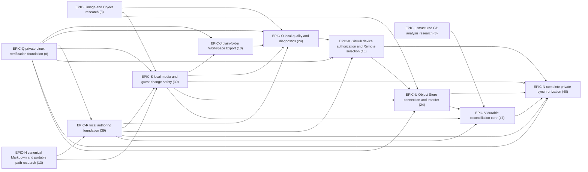

# Critical path

Generated by `constitution-tooling render` from `tasks/epics/`. Do not edit by hand; change the epic files and render again.

## Totals

| Active epics | Open points | Out-of-band epics | Out-of-band points | Waves | Widest wave | Longest chain (points) |
| :--- | :--- | :--- | :--- | :--- | :--- | :--- |
| 12 | 281 | 0 | 0 | 9 | 4 | 257 |

## Longest chain

EPIC-H → EPIC-R → EPIC-S → EPIC-J → EPIC-O → EPIC-K → EPIC-U → EPIC-V → EPIC-N (257 points). This bounds wall-clock time however many lanes run.

## Waves

An epic joins a wave when every dependency sits in an earlier wave and it is scope-disjoint from every other epic in the wave. A wave of one is a serial segment.

| Wave | Epic | Kind | Open points | Owns | May patch | Depends on |
| :--- | :--- | :--- | :--- | :--- | :--- | :--- |
| 1 | EPIC-H canonical Markdown and portable path research | tooling | 13 | `.constitution/spikes/SPK-BURL-H001.md`, `.constitution/spikes/SPK-BURL-H002.md` | `tech-spec/adrs/ADR-010-undo-command-stack.md`, `tech-spec/adrs/ADR-013-canonical-source-backed-markdown-ast.md`, `tech-spec/adrs/ADR-014-canonical-cross-platform-workspace-paths.md`, `tech-spec/adrs/ADR-021-selected-p0-markdown-profile.md` | — |
| 1 | EPIC-I image and Object research | tooling | 8 | `.constitution/spikes/SPK-BURL-I001.md` | `tech-spec/adrs/ADR-016-hybrid-local-assets-and-s3-compatible-objects.md`, `tech-spec/adrs/ADR-022-external-image-fetch-policy.md`, `tech-spec/contracts/external-image-fetch.meta.yaml` | — |
| 1 | EPIC-L structured Git analysis research | tooling | 8 | `.constitution/spikes/SPK-BURL-L001.md` | `tech-spec/adrs/ADR-015-structured-git-shaped-reconciliation-analysis.md` | — |
| 1 | EPIC-Q private Linux verification foundation | tooling | 8 | `scripts/private-linux-live.sh`, `scripts/visual-regression.sh`, `scripts/smoke-shot.sh`, `rust/src/security/**`, `rust/src/api/**`, `rust/src/frb_generated.rs`, `lib/main.dart`, `lib/src/smoke_isolation.dart`, `lib/src/rust/**`, `integration_test/**`, `integration_test/private_linux_driver_test.dart`, `test_driver/**`, `test/smoke_isolation_test.dart`, `test/visual_capture_driver_protocol_test.dart`, `devenv.nix`, `pubspec.yaml`, `pubspec.lock` | `tech-spec/guidelines.md`, `tech-spec/stack.yaml` | — |
| 2 | EPIC-R local authoring foundation | foundation | 39 | `rust/src/markdown/**`, `rust/src/okf/**`, `rust/src/workspace/**`, `rust/src/draft.rs`, `rust/src/index/**`, `rust/src/db/**`, `rust/src/api/**`, `rust/src/frb_generated.rs`, `rust/Cargo.toml`, `rust/Cargo.lock`, `lib/src/rust/**`, `lib/src/components/block_editor.dart`, `lib/src/components/block_view.dart`, `lib/src/components/editor.dart`, `lib/src/components/range_text_input_client.dart`, `lib/src/components/link_completion.dart`, `lib/src/providers/note_providers.dart`, `lib/src/providers/rust_api_provider.dart`, `lib/src/providers/workspace_provider.dart`, `lib/src/screens/workspace.dart`, `test/components/**`, `test/providers/**`, `test/screens/workspace_mounting_test.dart`, `integration_test/production_host_flow_test.dart`, `integration_test/local_authoring_flow_test.dart`, `pubspec.yaml`, `pubspec.lock` | `tech-spec/adrs/ADR-010-undo-command-stack.md`, `tech-spec/adrs/ADR-013-canonical-source-backed-markdown-ast.md`, `tech-spec/adrs/ADR-014-canonical-cross-platform-workspace-paths.md`, `tech-spec/adrs/ADR-021-selected-p0-markdown-profile.md`, `tech-spec/contracts/ffi_api.meta.yaml`, `tech-spec/data-models/schema.meta.yaml`, `tech-spec/guidelines.md`, `tech-spec/stack.yaml` | EPIC-H, EPIC-Q |
| 3 | EPIC-S local media and guest-change safety | product | 39 | `rust/src/assets/**`, `rust/src/external_image/**`, `rust/src/lib.rs`, `rust/src/workspace/**`, `rust/src/markdown/**`, `rust/src/index/**`, `rust/src/git/operations.rs`, `rust/src/api/**`, `rust/src/frb_generated.rs`, `rust/Cargo.toml`, `rust/Cargo.lock`, `lib/src/rust/**`, `lib/src/components/block_view.dart`, `lib/src/components/editor.dart`, `lib/src/providers/note_providers.dart`, `lib/src/providers/workspace_provider.dart`, `lib/src/screens/workspace.dart`, `linux/**`, `test/components/**`, `test/providers/**`, `test/screens/workspace_rescan_test.dart`, `integration_test/**`, `integration_test/local_media_flow_test.dart`, `integration_test/external_image_flow_test.dart`, `integration_test/workspace_observer_flow_test.dart`, `scripts/private-linux-live.sh`, `pubspec.yaml`, `pubspec.lock` | `tech-spec/adrs/ADR-010-undo-command-stack.md`, `tech-spec/adrs/ADR-013-canonical-source-backed-markdown-ast.md`, `tech-spec/adrs/ADR-016-hybrid-local-assets-and-s3-compatible-objects.md`, `tech-spec/adrs/ADR-022-external-image-fetch-policy.md`, `tech-spec/contracts/external-image-fetch.meta.yaml`, `tech-spec/contracts/ffi_api.meta.yaml`, `tech-spec/data-models/schema.meta.yaml`, `tech-spec/guidelines.md`, `tech-spec/stack.yaml` | EPIC-H, EPIC-I, EPIC-Q, EPIC-R |
| 4 | EPIC-J plain-folder Workspace Export | product | 13 | `rust/src/export/**`, `rust/src/workspace/**`, `rust/src/assets/**`, `rust/src/api/**`, `rust/src/frb_generated.rs`, `lib/src/rust/**`, `lib/src/providers/workspace_provider.dart`, `lib/src/screens/workspace.dart`, `lib/src/components/**`, `lib/l10n/**`, `test/components/**`, `test/providers/**`, `test/screens/**`, `integration_test/**`, `integration_test/plain_folder_export_flow_test.dart` | `tech-spec/contracts/ffi_api.meta.yaml`, `tech-spec/data-models/schema.meta.yaml`, `tech-spec/guidelines.md` | EPIC-Q, EPIC-S |
| 5 | EPIC-O local quality and diagnostics | product | 24 | `rust/src/diagnostics/**`, `rust/src/workspace/**`, `rust/src/git/**`, `rust/src/db/**`, `rust/src/security/**`, `rust/src/api/**`, `rust/src/frb_generated.rs`, `rust/Cargo.toml`, `rust/Cargo.lock`, `rust/benches/**`, `lib/src/rust/**`, `lib/src/components/**`, `lib/src/providers/**`, `lib/src/screens/workspace.dart`, `lib/l10n/**`, `test/**`, `integration_test/**`, `integration_test/local_quality_flow_test.dart`, `integration_test/private_linux_performance_test.dart`, `scripts/**`, `scripts/private-linux-live.sh` | `tech-spec/adrs/ADR-011-local-diagnostics.md`, `tech-spec/contracts/ffi_api.meta.yaml`, `tech-spec/data-models/schema.meta.yaml`, `tech-spec/data-models/workspace-session-snapshot.schema.meta.yaml`, `tech-spec/guidelines.md` | EPIC-I, EPIC-J, EPIC-Q, EPIC-R, EPIC-S |
| 6 | EPIC-K GitHub device authorization and Remote selection | foundation | 18 | `rust/src/provider/**`, `rust/src/provider/github_device_flow.rs`, `rust/src/security/**`, `rust/src/api/auth.rs`, `rust/src/api/ffi_api.rs`, `rust/src/api/mod.rs`, `rust/src/frb_generated.rs`, `rust/Cargo.toml`, `rust/Cargo.lock`, `lib/src/rust/**`, `lib/src/providers/auth_provider.dart`, `lib/src/screens/login.dart`, `lib/src/components/**`, `lib/l10n/**`, `test/providers/auth_provider_test.dart`, `test/screens/login_test.dart`, `integration_test/**`, `integration_test/github_device_flow_fixture_test.dart` | `tech-spec/adrs/ADR-009-provider-seam.md`, `tech-spec/adrs/ADR-017-github-app-device-flow.md`, `tech-spec/contracts/github-app-device-flow.meta.yaml`, `tech-spec/contracts/ffi_api.meta.yaml`, `tech-spec/guidelines.md`, `tech-spec/stack.yaml` | EPIC-O, EPIC-Q, EPIC-R |
| 7 | EPIC-U Object Store connection and transfer | foundation | 24 | `rust/src/object_store/**`, `rust/src/assets/**`, `rust/src/security/**`, `rust/src/workspace/**`, `rust/src/api/**`, `rust/src/frb_generated.rs`, `rust/Cargo.toml`, `rust/Cargo.lock`, `lib/src/rust/**`, `lib/src/components/**`, `lib/src/providers/**`, `lib/src/screens/workspace.dart`, `lib/l10n/**`, `test/**`, `integration_test/**`, `integration_test/object_store_fixture_test.dart`, `pubspec.yaml`, `pubspec.lock` | `tech-spec/adrs/ADR-016-hybrid-local-assets-and-s3-compatible-objects.md`, `tech-spec/contracts/ffi_api.meta.yaml`, `tech-spec/data-models/schema.meta.yaml`, `tech-spec/guidelines.md`, `tech-spec/stack.yaml` | EPIC-I, EPIC-K, EPIC-Q, EPIC-S |
| 8 | EPIC-V durable reconciliation core | foundation | 47 | `rust/src/git/**`, `rust/src/sync/**`, `rust/src/workspace/**`, `rust/src/markdown/**`, `rust/src/assets/**`, `rust/src/object_store/**`, `rust/src/db/**`, `rust/Cargo.toml`, `rust/Cargo.lock`, `test/**` | `tech-spec/adrs/ADR-013-canonical-source-backed-markdown-ast.md`, `tech-spec/adrs/ADR-015-structured-git-shaped-reconciliation-analysis.md`, `tech-spec/adrs/ADR-016-hybrid-local-assets-and-s3-compatible-objects.md`, `tech-spec/data-models/schema.meta.yaml`, `tech-spec/guidelines.md`, `tech-spec/stack.yaml` | EPIC-L, EPIC-R, EPIC-S, EPIC-U |
| 9 | EPIC-N complete private synchronization | product | 40 | `rust/src/provider/**`, `rust/src/git/**`, `rust/src/sync/**`, `rust/src/object_store/**`, `rust/src/assets/**`, `rust/src/markdown/**`, `rust/src/workspace/**`, `rust/src/security/**`, `rust/src/db/**`, `rust/src/api/**`, `rust/src/frb_generated.rs`, `rust/Cargo.toml`, `rust/Cargo.lock`, `lib/src/rust/**`, `lib/src/components/**`, `lib/src/components/editor.dart`, `lib/src/components/block_view.dart`, `lib/src/providers/**`, `lib/src/providers/note_providers.dart`, `lib/src/screens/**`, `lib/l10n/**`, `test/**`, `integration_test/**`, `integration_test/private_sync_two_device_test.dart`, `integration_test/private_sync_real_provider_test.dart`, `integration_test/github_device_flow_real_test.dart`, `test_driver/**`, `scripts/private-linux-live.sh`, `pubspec.yaml`, `pubspec.lock` | `tech-spec/adrs/ADR-009-provider-seam.md`, `tech-spec/adrs/ADR-015-structured-git-shaped-reconciliation-analysis.md`, `tech-spec/adrs/ADR-016-hybrid-local-assets-and-s3-compatible-objects.md`, `tech-spec/adrs/ADR-017-github-app-device-flow.md`, `tech-spec/contracts/ffi_api.meta.yaml`, `tech-spec/contracts/github-app-device-flow.meta.yaml`, `tech-spec/data-models/schema.meta.yaml`, `tech-spec/data-models/workspace-session-snapshot.schema.meta.yaml`, `tech-spec/guidelines.md` | EPIC-K, EPIC-Q, EPIC-R, EPIC-S, EPIC-U, EPIC-V |

## Build order

An arrow points from a prerequisite to the epic that depends on it, so it reads in the order work flows, the same direction as the longest chain above.

## Ticket order inside each epic

A dependency-respecting listing, not a chain: `needs` names a ticket's own `depends_on` inside its epic, and a ticket without one has no in-epic dependency. Readiness is epic-level: a ticket finished on an unmerged branch satisfies no other epic's dependency until the containing PR merges.

- **EPIC-H:** BURL-H001, BURL-H002
- **EPIC-I:** BURL-I001
- **EPIC-J:** BURL-J001, BURL-J002 (needs BURL-J001), BURL-J006 (needs BURL-J002)
- **EPIC-L:** BURL-L001
- **EPIC-O:** BURL-O002, BURL-O005 (needs BURL-O002), BURL-O016 (needs BURL-O002), BURL-O004 (needs BURL-O002, BURL-O005, BURL-O016)
- **EPIC-Q:** BURL-Q001
- **EPIC-R:** BURL-R001, BURL-R002, BURL-R003 (needs BURL-R001, BURL-R002), BURL-R004 (needs BURL-R003), BURL-R005 (needs BURL-R004), BURL-R006 (needs BURL-R005), BURL-R007 (needs BURL-R002, BURL-R004, BURL-R005, BURL-R006)
- **EPIC-S:** BURL-S001, BURL-S002 (needs BURL-S001), BURL-S003 (needs BURL-S002), BURL-S004 (needs BURL-S001), BURL-S005 (needs BURL-S004), BURL-S006 (needs BURL-S004, BURL-S005)
- **EPIC-K:** BURL-K001, BURL-K002 (needs BURL-K001), BURL-K003 (needs BURL-K002)
- **EPIC-N:** BURL-N001, BURL-N012, BURL-N013 (needs BURL-N012), BURL-N014 (needs BURL-N012, BURL-N013), BURL-N015 (needs BURL-N001, BURL-N013, BURL-N014), BURL-N011 (needs BURL-N001, BURL-N012, BURL-N013, BURL-N014, BURL-N015)
- **EPIC-U:** BURL-U001, BURL-U002 (needs BURL-U001), BURL-U003 (needs BURL-U002), BURL-U004 (needs BURL-U001)
- **EPIC-V:** BURL-V001, BURL-V002 (needs BURL-V001), BURL-V003 (needs BURL-V001), BURL-V004 (needs BURL-V001), BURL-V005 (needs BURL-V001), BURL-V006 (needs BURL-V003, BURL-V004, BURL-V005), BURL-V007 (needs BURL-V002), BURL-V008 (needs BURL-V003, BURL-V004)

## Concurrency mechanics

- **Worktree:** ../burlmd-<branch-slug>, created from merged master
- **Branch naming:** <type>/epic-<epic-id>-<slug>, for example feat/epic-g-desktop-session
- **Merge strategy:** rebase
